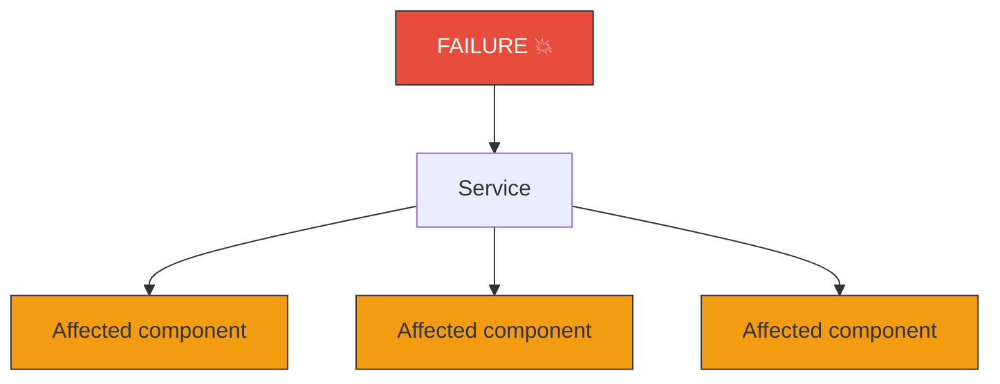
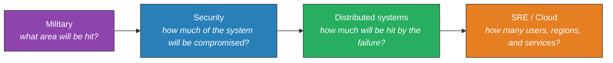
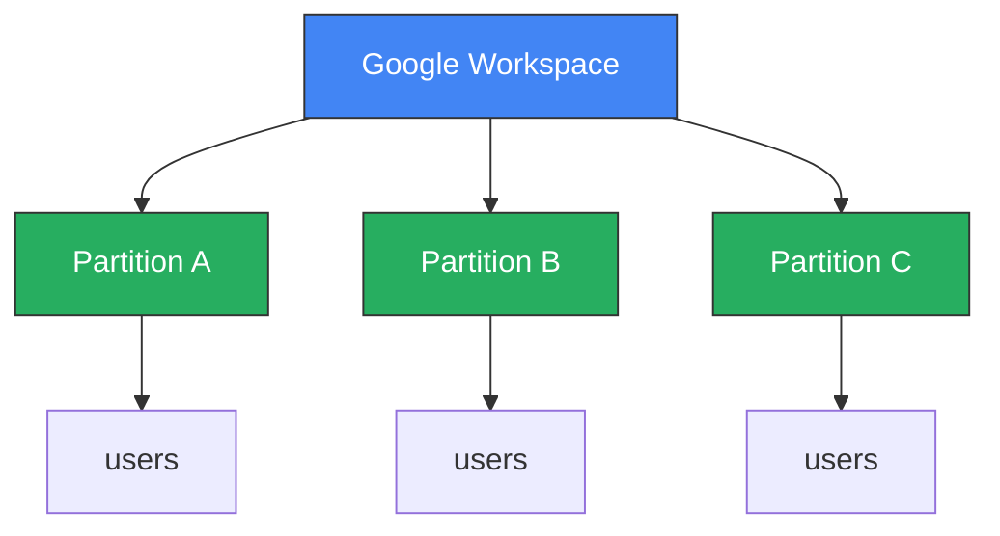
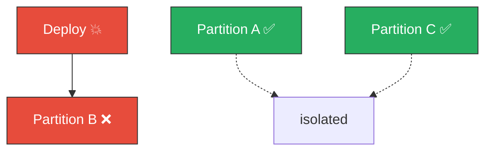
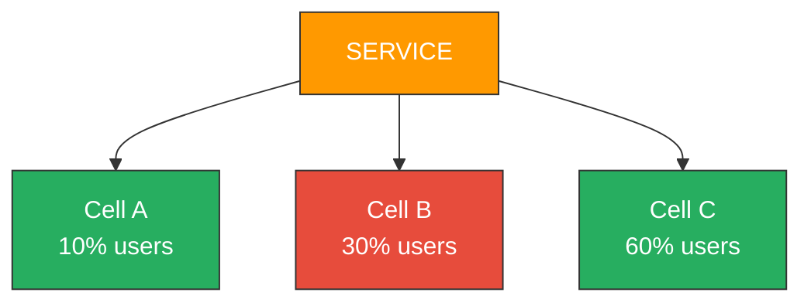
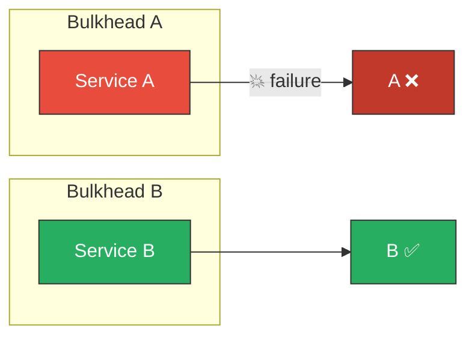
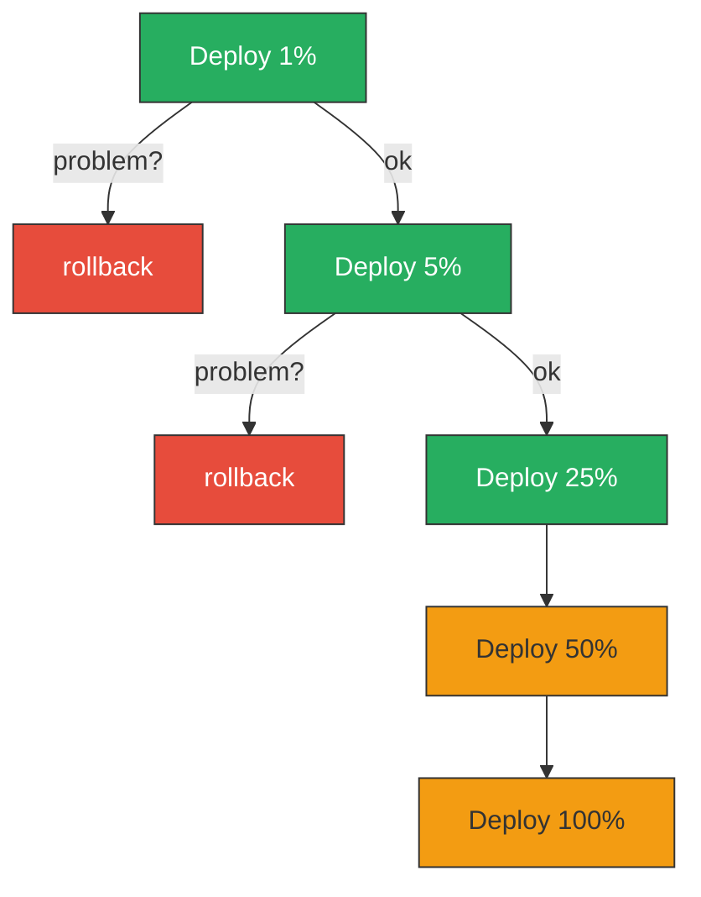
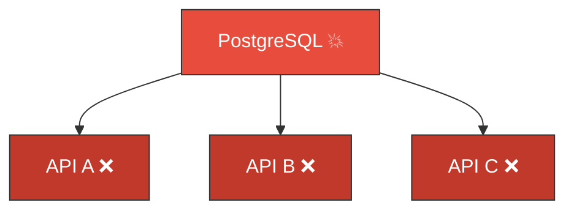
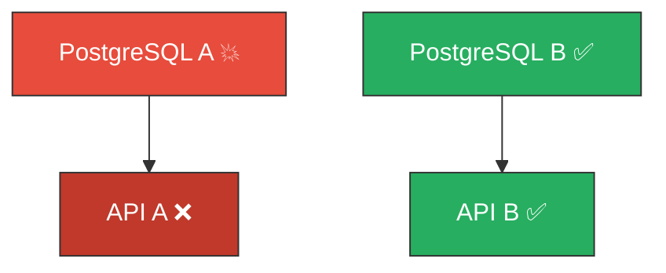

If you work with distributed systems, SRE, or cloud, you've heard the question:

> "If this service goes down, what happens?"

That is, in practice, the operational definition of **blast radius**.

But where did this term come from? Who brought this language into software engineering? The answer is more interesting than it seems, because "blast radius" wasn't born in software. It is a metaphor borrowed directly from military and explosives vocabulary.

## Where it comes from

Originally, blast radius is the radius around an explosion that suffers the effects of the blast. It is a term associated with explosives, weapons, and detonations.

The idea carried over to systems is almost literal: **a failure is the explosion; the set of affected components and users is the blast radius.**

## But when did this enter software?

There is an important distinction here: **there doesn't seem to be a single documented inventor** of the term in software.

The concept of confining failures is much older than the term. Principles like [*least privilege*](https://www.ibm.com/br-pt/think/topics/principle-of-least-privilege) already sought to limit what a failure or compromise could reach. The [**bulkhead**](https://fidelissauro.dev/bulkheads/) pattern uses exactly the same idea: divide a system into compartments so that a problem in one does not sink the entire ship.

What happened in practice was a gradual evolution:

## Google SRE popularized the idea

The concept became particularly strong with **Site Reliability Engineering** culture.

Google started explicitly treating the size of a failure as something that should be architecturally controlled. Today, Google documentation openly talks about *"reducing the blast radius"* through gradual deployments, canary releases, and partitioning.

The Google SRE Workbook uses the expression consistently when discussing incidents and postmortems. In one documented case, an automation ended up affecting machines globally; after the fixes, Google reports that the second incident had its **blast radius reduced**.

In an official Google SRE podcast, engineers discuss *"limit blast radius"* as an explicit goal of migrations, using gradual rollouts to control impact.

It is not an occasional metaphor. It became part of the operational vocabulary.

### Google Workspace: a concrete case

In 2025, Google engineers described an architecture in which the Google Workspace infrastructure is divided into **partitions**, allowing a change to be applied to one partition at a time:

If the deploy breaks in Partition B:

Instead of affecting the whole production environment, only a fraction of users is impacted. Google explicitly calls this *"limiting the blast radius"*.

## AWS turned it into an architectural principle

In AWS architecture culture, blast radius became practically a design principle.

AWS uses the concept to discuss:

- Availability Zones and Regions
- accounts and workload isolation
- cells and shards
- gradual deployments
- IAM permissions (*least privilege*)
- dependency isolation

**Cell-based architecture** is described precisely as a way to limit blast radius:

If Cell B fails, you do not have a global failure. AWS even describes **shuffle sharding** as a technique to further reduce the number of customers sharing the same failure domain.

An Amazon engineer once described the problem of a library being distributed to tens of thousands of repositories as a *"big blast radius"*, showing that the concept is not restricted to infrastructure — it also applies to software changes and dependencies.

At AWS re:Invent 2018, Peter Vosshall gave a presentation titled [How AWS Minimizes the Blast Radius of Failures](https://www.youtube.com/watch?v=swQbA4zub20).

## The connection with Bulkhead

It is worth keeping this distinction:

- **Bulkhead** is the isolation mechanism.
- **Blast radius** is the size of the damage/impact.

The bulkhead **limited** the blast radius. The impact of the failure was contained, and Service B was not affected.

## Canary deployment is also about this

The goal is not necessarily to prevent the failure. It is: **if it blows up, let it blow up small.**

## A practical definition

AWS defines blast radius quite directly as the **maximum impact that can be sustained when a failure occurs**.

This allows thinking of it almost as an architectural property:

> **Blast Radius** = maximum number of things that can be affected by a single failure event

And then several techniques emerge that you probably already use without necessarily calling them "blast radius":

| Technique | What it limits |
| --- | --- |
| Circuit breaker | Cascading failure |
| Timeout | Wait propagation |
| Bulkhead | Shared resources |
| Rate limiting | Overload |
| Canary deployment | Users affected by deploy |
| Feature flag | Affected functionality |
| Sharding | Data/users |
| Cell architecture | Infrastructure |
| Multi-AZ | Zone failure |
| Multi-region | Regional failure |
| IAM least privilege | Compromise impact |
| Account isolation | Cross-workload impact |
| Queue | Cross-service propagation |

## A practical example

Consider two architectures with the same database as a dependency:

**Architecture A** (large blast radius):

**Architecture B** (reduced blast radius):

Same failure, much smaller impact.

## Who "coined" the term?

There is no evidence that a specific person at Google or AWS invented the term. What can be documented is this:

| Period | Who | Role |
| --- | --- | --- |
| Pre-software | Military engineering | Literal origin of the expression |
| ~1990s | Security community | Adaptation of the idea of an "affected area" |
| ~2000s | Software engineering | Isolation, bulkheads, failure domains |
| ~2010s | Google SRE | Turns it into operational reliability language |
| ~2010s | AWS | Turns it into a cloud architectural principle |
| 2020s | SRE/Cloud at large | Becomes general distributed systems vocabulary |

Google now uses the expression so explicitly that a 2025 official publication is literally titled *"Avoid global outages by partitioning cloud applications to reduce blast radius"*.

## At the end of the day

"Reducing blast radius" is a modern way of expressing one of the oldest ideas in engineering: **isolate things so that a failure doesn't become a systemic catastrophe**.

The term became strong in SRE + cloud + distributed systems because it turns an abstract reliability question into a very concrete one:

> **"If this thing blows up right now, what exactly goes with it?"**

That's an excellent question to ask during a design review of any distributed system.

## References

- [Google SRE Workbook](https://sre.google)
- [Least Privilege Principle](https://www.ibm.com/br-pt/think/topics/principle-of-least-privilege)
- [Bulkhead Pattern](https://fidelissauro.dev/bulkheads/)
- [How AWS Minimizes the Blast Radius of Failures](https://www.youtube.com/watch?v=swQbA4zub20)
