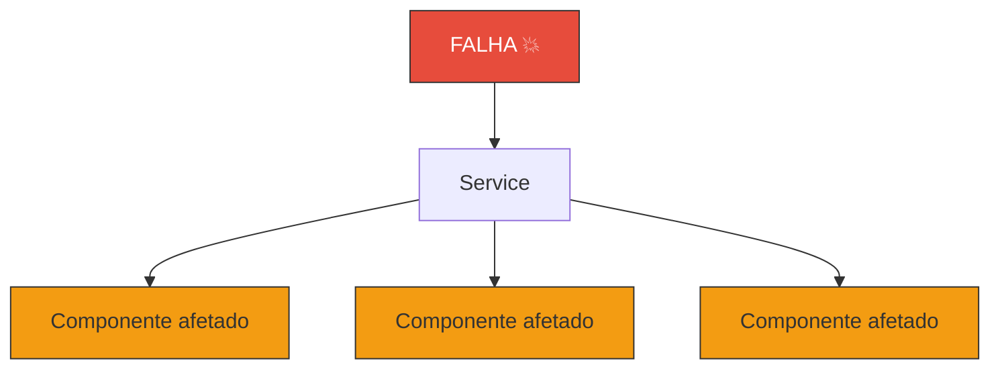
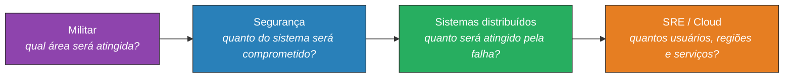
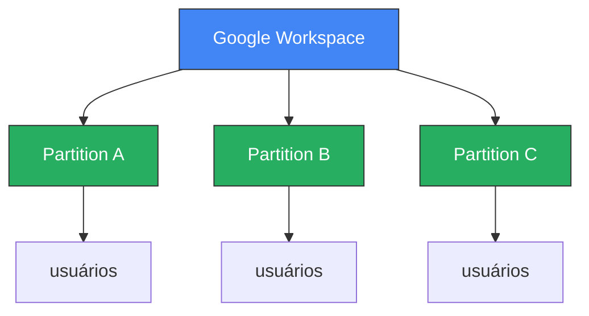
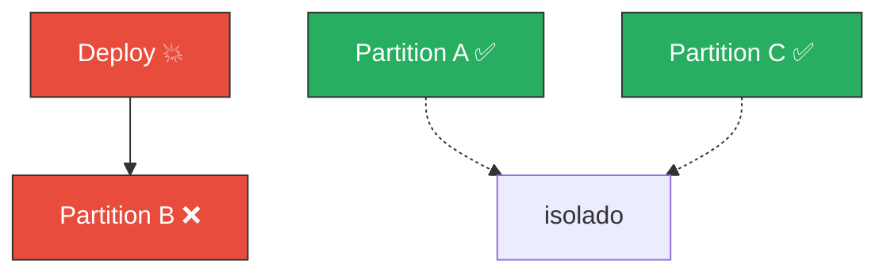
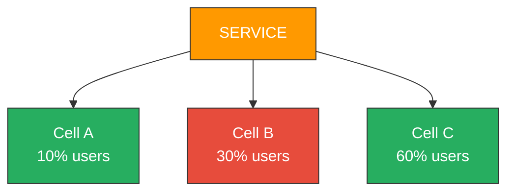
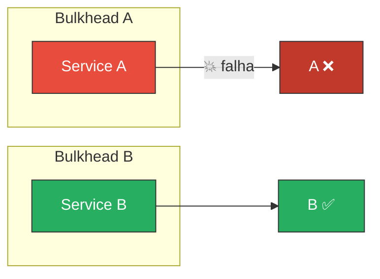
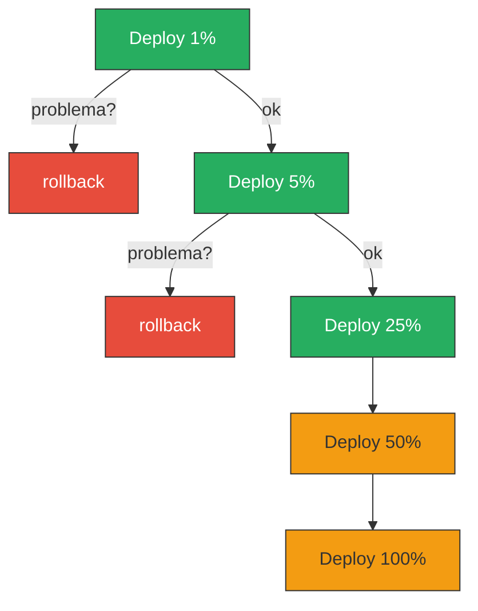
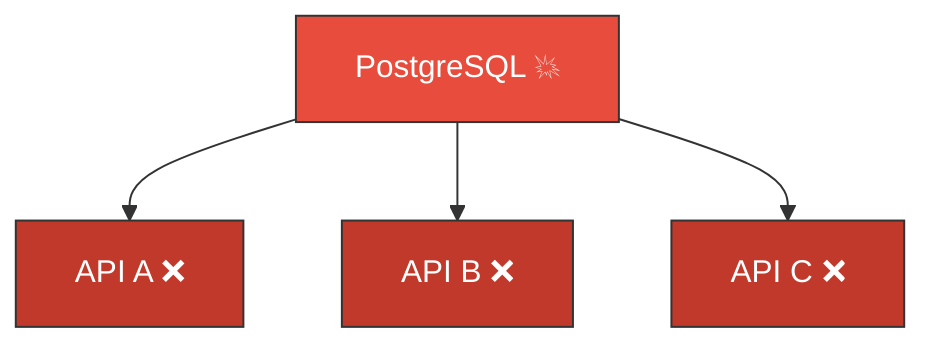
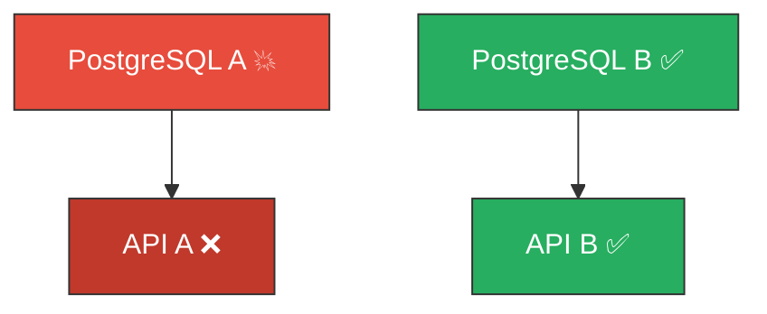

Se você trabalha com sistemas distribuídos, SRE ou cloud, já ouviu a pergunta:

> "Se esse serviço aqui parar, o que acontece?"

Mas de onde veio esse termo? Quem trouxe essa linguagem para dentro da engenharia de software? A resposta é mais interessante do que parece, porque "blast radius" não nasceu em engenharia de software. É uma metáfora emprestada do vocabulário militar.

## De onde vem

Originalmente, **blast radius** é o raio ao redor de uma explosão que sofre seus efeitos. É um termo associado a explosivos, armas e detonações.

A ideia transportada para sistemas é quase literal: **uma falha de um componente que afeta o conjunto de componentes e chega até os usuários.**

## Mas quando isso entrou em engenharia de software?

Aqui existe uma distinção importante: **não parece haver um único inventor documentado** do uso em engenharia desoftware.

O conceito de confinar falhas é muito mais antigo que o termo. Princípios como [*least privilege*](https://www.ibm.com/br-pt/think/topics/principle-of-least-privilege) já buscavam limitar o que uma falha ou comprometimento poderia atingir. O padrão de [**bulkhead**](https://fidelissauro.dev/bulkheads/) usa exatamente a mesma ideia: dividir um sistema em compartimentos para que um problema em um compartimento não afunde o navio inteiro.

O que aconteceu na prática foi uma evolução gradual:

## Google SRE popularizou a ideia

O conceito ficou particularmente forte com a cultura de [**Site Reliability Engineering**](https://sre.google/).

O Google passou a tratar explicitamente o tamanho de uma falha como algo que deveria ser controlado arquiteturalmente. Hoje a documentação do Google fala abertamente em *"reduce the blast radius"* através de deployments graduais, canary releases e particionamento.

O Google SRE Workbook usa a expressão de forma consistente ao discutir incidentes e postmortems. Em um caso documentado, uma automação acabou afetando máquinas globalmente; depois das correções, o Google relata no postmortemque o segundo incidente teve seu **blast radius reduzido**.

Em um podcast oficial do Google SRE, engenheiros discutem *"limit blast radius"* como objetivo explícito de migrações, usando rollout gradual para controlar o impacto.

Não é uma metáfora ocasional. Virou parte do vocabulário operacional.

### Google Workspace: um caso concreto

Em 2025, engenheiros do Google descreveram uma arquitetura em que a infraestrutura do Google Workspace é dividida em **partitions**, permitindo aplicar uma mudança em uma partição por vez:

Se o deploy quebrar na Partition B:

Em vez de afetar a produção inteira, apenas uma fração dos usuários é impactada. O Google chama isso explicitamente de *"limit the blast radius"*.

## AWS transformou em princípio arquitetural

Na cultura de arquitetura da AWS, blast radius virou praticamente um princípio de design.

A AWS usa o conceito para discutir:

- Availability Zones e Regions
- accounts e isolamento entre workloads
- células e shards
- deployments graduais
- permissões IAM (*least privilege*)
- isolamento de dependências

A **cell-based architecture** é descrita justamente como uma forma de limitar o blast radius:

Se a Cell B falha, você não tem uma falha global. A AWS inclusive descreve **shuffle sharding** como uma técnica para reduzir ainda mais o número de clientes que compartilham o mesmo domínio de falha.

Um engenheiro da Amazon chegou a descrever o problema de uma biblioteca sendo distribuída para dezenas de milhares de repositórios como um *"big blast radius"*, mostrando que o conceito não se restringe à infraestrutura, mas também a mudanças de software e dependências.

Nesse AWS re:Invent 2018, Peter Vosshall faz uma apresentação [How AWS Minimizes the Blast Raius of Failures](https://www.youtube.com/watch?v=swQbA4zub20).

## A conexão com Bulkhead

Vale guardar esta distinção:

- **Bulkhead** é o mecanismo de isolamento. Você cria compartimentos para que uma falha não se propague.
- **Blast radius** é o tamanho do dano/impacto. Quanto maior o blast radius, mais coisas são afetadas por uma falha.

O bulkhead **limitou** o blast radius. O impacto da falha foi contido, e o serviço B não foi afetado.

## Canary deployment também é sobre isso

O objetivo não é necessariamente evitar a falha. É: **se um componente falhar, atinja o menor número de componentes possíveis.**

## Uma definição prática

A AWS define blast radius de forma bastante direta como o **impacto máximo que pode ser sustentado quando ocorre uma falha**.

Isso permite pensar nele quase como uma propriedade arquitetural:

> **Blast Radius** = quantidade máxima de coisas que podem ser afetadas por um único evento de falha

E aí surgem várias técnicas que provavelmente já são usadas sem necessariamente chamá-las de "blast radius":

| Técnica | O que limita |
| --- | --- |
| Circuit breaker | Cascading failure |
| Timeout | Propagação de espera |
| Bulkhead | Recursos compartilhados |
| Rate limiting | Sobrecarga |
| Canary deployment | Usuários afetados por deploy |
| Feature flag | Funcionalidade afetada |
| Sharding | Dados/usuários |
| Cell architecture | Infraestrutura |
| Multi-AZ | Falha de zona |
| Multi-region | Falha regional |
| IAM least privilege | Impacto de comprometimento |
| Account isolation | Impacto entre workloads |
| Queue | Propagação entre serviços |

## Um exemplo prático

Considere duas arquiteturas com o mesmo banco de dados como dependência:

**Arquitetura A** (blast radius grande):

**Arquitetura B** (blast radius reduzido):

A mesma falha, impacto muito menor.

## Quem "batizou" o termo?

Não há evidência de que uma pessoa específica do Google ou da AWS tenha inventado o termo. O que se pode documentar:

| Período | Quem | Papel |
| --- | --- | --- |
| Antes de software | Engenharia militar | Origem literal da expressão |
| ~1990s | Comunidade de segurança | Adaptação da ideia de "área afetada" |
| ~2000s | Engenharia de software | Isolamento, bulkheads, failure domains |
| ~2010s | Google SRE | Transforma em linguagem operacional de confiabilidade |
| ~2010s | AWS | Transforma em princípio arquitetural de cloud |
| 2020s | SRE/Cloud em geral | Torna-se vocabulário geral de sistemas distribuídos |

O Google hoje usa a expressão de maneira tão explícita que uma publicação oficial de 2025 se chama literalmente *"Avoid global outages by partitioning cloud applications to reduce blast radius"*.

## O que importante saber

"Reduzir blast radius" é uma maneira moderna de expressar uma das ideias mais antigas de engenharia: **isole as coisas para que uma falha não se torne uma catástrofe sistêmica**.

O termo ficou forte em SRE + cloud + sistemas distribuídos porque transforma uma pergunta abstrata de confiabilidade em uma pergunta muito concreta:

> **"Se isso aqui explodir agora, o que exatamente vai junto?"**

Essa é uma pergunta excelente para fazer durante um design review de qualquer sistema distribuído.

## Referências

- [Google SRE Workbook](https://sre.google)
- [Least Privilege Principle](https://www.ibm.com/br-pt/think/topics/principle-of-least-privilege)
- [Bulkhead Pattern](https://fidelissauro.dev/bulkheads/)
- [How AWS Minimizes the Blast Radius of Failures](https://www.youtube.com/watch?v=swQbA4zub20)
